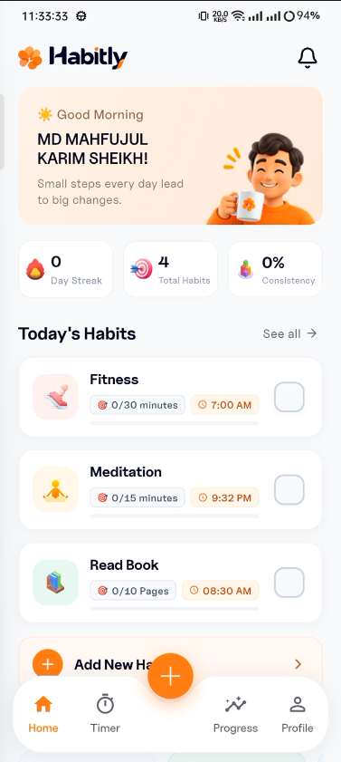

# Habitly - Official Landing Page

A modern, high-converting, and responsive landing page for **Habitly** — the daily habit tracker and Pomodoro focus app by [Appstick](https://appstick.com.bd/).



## ✨ Features

- **Pixel-Perfect Hero Section**: Authentic app mockups, crisp typography, and direct download links.
- **Value Proposition Bar**: 4 highlight cards for Habit Tracking, Focus & Productivity, Visual Progress, and Goal Building.
- **Interactive Focus Timer Demo**: A live, working Pomodoro timer directly in the browser with preset switches (15m, 25m, 30m, 45m, 60m) matching the app and circular SVG progress ring.
- **Dedicated Legal Pages**: Standalone, fully compliant **Privacy Policy** (with explicit Account Deletion steps) and **Terms & Conditions** with sticky table of contents navigation.
- **Clean & Modern Aesthetic**: Crisp light aesthetics with vibrant orange brand accents.
- **Responsive Design**: Flawlessly optimized across Mobile, Tablet, Laptop, and Desktop screens.
- **Zero External Dependencies**: Pure HTML5, Vanilla CSS3, and modern Vanilla JavaScript for lightning-fast loading speeds.

## 🚀 Getting Started

To view the landing page locally:

1. Clone or navigate to the directory:
   ```bash
   cd Habitly_frontend
   ```

2. Start a simple local server:
   ```bash
   # Using Python
   python -m http.server 8080

   # Or using Node.js / npx
   npx serve .
   ```

3. Open your browser at `http://localhost:8080`.

## 📁 Project Structure

```
Habitly_frontend/
├── index.html                  # Main landing page HTML
├── privacy-policy.html         # Dedicated Privacy Policy page
├── terms-and-conditions.html   # Dedicated Terms & Conditions page
├── assets/
│   ├── css/
│   │   └── style.css           # Vanilla CSS with custom properties & responsive queries
│   ├── js/
│   │   └── main.js             # Vanilla JS for timer, scrollspy, FAQs & mobile nav
│   └── images/
│       ├── app_icon.png        # App icon mark
│       ├── favicon.png         # Browser favicon
│       ├── screen_home.png     # App Home screen screenshot
│       ├── screen_timer.png    # Focus Timer screen screenshot
│       ├── screen_progress.png # Progress & Analytics screen screenshot
│       ├── screen_habit_detail.png # Habit Detail screen screenshot
│       └── screen_profile.png  # User Profile screen screenshot
├── screenshot/                 # Source raw app screenshots
└── README.md
```

## 🎨 Design System

- **Primary Orange**: `#FF6A00` / `#FF8533`
- **Primary Gradient**: `linear-gradient(135deg, #FF6A00 0%, #FF8533 100%)`
- **Backgrounds**: `#FFFFFF` (Light) / `#FAF8F6` (Alt)
- **Typography**: `Plus Jakarta Sans` & `Caveat` (Google Fonts)

---
© 2026 Habitly. Developed by [Appstick](https://appstick.com.bd/). All rights reserved.
